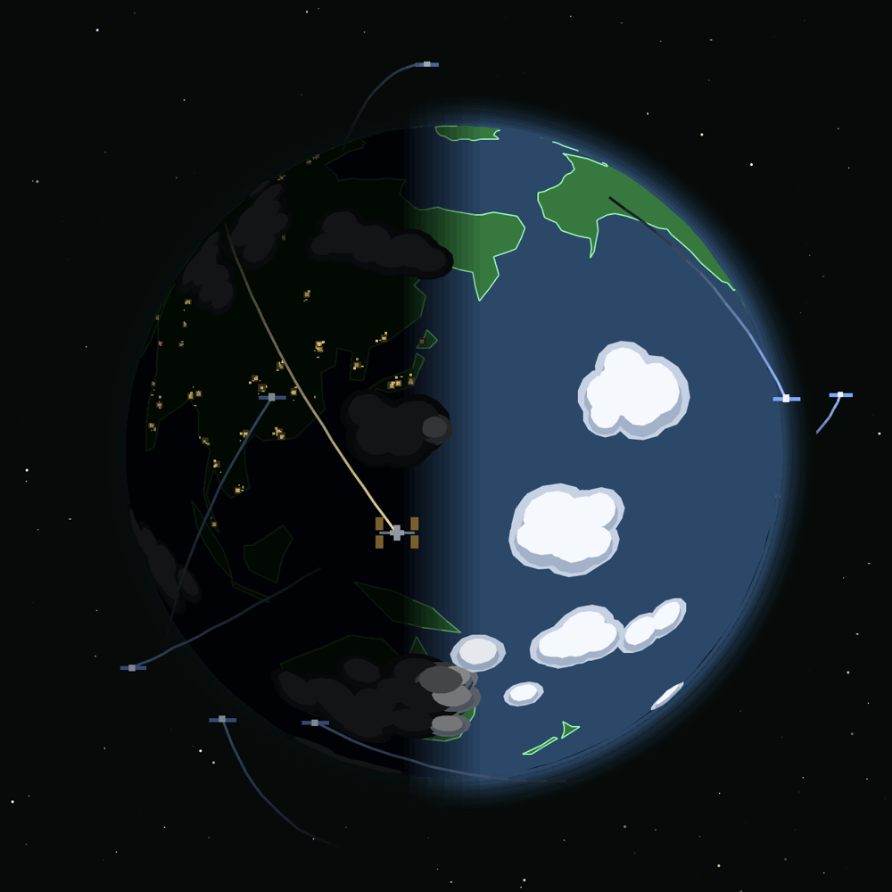

# Spinning Earth

An animated, rotating globe in pure Python: green continents on a blue ocean, a day/night terminator, city lights, clouds, an atmosphere, satellites and the ISS against a starry sky. No third-party libraries - only the Python standard library.



## Features

- **Day and night** - the left hemisphere is in darkness, with a smooth gradient across the middle.
- **City lights** on the night side (132 major cities, each surrounded by smaller lights). They switch off as a city approaches the daylight.
- **Clouds** - fluffy, with a shadow underneath. They are destroyed past the right horizon and created behind the left one, so there is no visible repeat after a full revolution. They darken at night.
- **Atmosphere** - a translucent glow around the globe that fades out on the night side.
- **10 satellites** on different orbits with trails, and the **ISS** on an orbit with its real 51.6° inclination.
- **Stars** that pulse slowly.
- **Fullscreen** - the picture scales together with the window.
- The animation is driven by real time, so the speed is the same in a window and in fullscreen, and on a fast or a slow computer.
- **Control panel** - a live FPS counter and a checkbox for every layer, so you can switch layers on and off yourself (see [Control panel](#control-panel)).
- **Automatic quality** - on a slow machine the program drops detail step by step until the animation runs smoothly. It can be switched off with a checkbox (see [Performance](#performance)).

## Requirements

- **Python 3** with **tkinter** support (`turtle` runs on top of it).
- No packages from PyPI are needed: there is no `pip install` step and no `requirements.txt`. The code only imports `math`, `random`, `time` and `turtle`.

Tested on Python 3.14 (Tk 9.0) on macOS. The code does not use anything specific to recent Python versions, but it has not been run on older ones.

### Check that tkinter is available

```bash
python3 -m tkinter
```

A small "tkinter" window should open. If you get `No module named '_tkinter'` (or `tkinter`) instead, install it using the instructions for your system below.

### Installing tkinter

| System | Command |
|---|---|
| **macOS** (Python from [python.org](https://www.python.org/downloads/)) | Nothing to do - tkinter is bundled. |
| **macOS** (Homebrew) | `brew install python-tk` (or `python-tk@3.13` - use your Python version) |
| **Ubuntu / Debian** | `sudo apt install python3-tk` |
| **Fedora** | `sudo dnf install python3-tkinter` |
| **Arch Linux** | `sudo pacman -S tk` |
| **Windows** | Nothing to do if you installed Python from [python.org](https://www.python.org/downloads/). Make sure *tcl/tk and IDLE* was ticked during installation. |

On macOS, avoid the Python that ships with the system: it uses an outdated Tk that runs unreliably. Prefer Python from python.org or Homebrew.

## Running

```bash
cd globe
python3 index.py
```

On Windows use `python` or `py` instead of `python3`.

## Controls

| Action | Result |
|---|---|
| `F` or `F11` | toggle fullscreen |
| double-click the globe | same |
| `H` | hide / show the control panel |
| `Esc` | leave fullscreen |
| close the window | quit |

The scale follows the smaller side of the window, so on wide screens the globe simply gets more space around it.

## Control panel

The panel on the left shows the current **FPS** and the **graphics level** (`full`, or `reduced` / `low` / `minimal (auto)` if the automatic quality reduction has kicked in). Below it is one checkbox per layer:

| Checkbox | Layer |
|---|---|
| Stars | background stars |
| Atmosphere | the glow around the globe |
| Ocean | the ocean disc |
| Continents | land and coastlines |
| Day / night | the night side and the gradient between day and night |
| City lights | lights on the night side |
| Clouds | clouds |
| Satellites | the satellites and their trails |
| ISS | the space station |

A ticked box means the layer is shown; an unticked one hides it completely (and a hidden layer costs nothing to draw, so switching layers off also raises the frame rate).

- **Day / night** off means the whole globe is lit evenly and the atmosphere is not dimmed. City lights only exist at night, so they disappear too.
- **Auto-reduce graphics** is the automatic quality reduction for slow computers (see [Performance](#performance)). Untick it and the graphics will never be degraded automatically; if it had already degraded them, they are restored to full at once.
- The panel is a column next to the picture, not an overlay: native widgets on top of a canvas that is redrawn every frame make macOS recompose them constantly, which cost about 25 FPS in testing. Hiding it with `H` shrinks the window back by the panel's width.
- Set `SHOW_PANEL = False` in [index.py](index.py) to start with the panel hidden.

## Configuration

All parameters are constants at the top of [index.py](index.py). Change a value and run it again.

| Constant | What it changes |
|---|---|
| `WIDTH`, `HEIGHT`, `RADIUS` | window and globe size |
| `SPEED` | rotation speed (degrees per animation step; one step = `TICK_MS` ms) |
| `TARGET_FPS` | frame rate to aim for (the speed of motion does not depend on it) |
| `SHOW_PANEL` | whether the control panel is visible at start |
| `AUTO_QUALITY`, `QUALITY_MIN_FPS`, `QUALITY_WINDOW` | automatic quality reduction on slow machines, the frame rate below which it kicks in, and how many recent frames it looks at |
| `TILT` | tilt of the Earth's axis |
| `OCEAN`, `LAND_FILL`, `LAND_EDGE` | ocean and land colours |
| `NIGHT_START`, `NIGHT_END`, `NIGHT_DARKNESS` | where the day-to-night transition starts and ends, and how dark the night side gets |
| `ATMO_COLOR`, `ATMO_WIDTH`, `ATMO_STRENGTH` | colour, thickness and brightness of the atmosphere |
| `CLOUD_SYSTEMS` | number of cloud clusters |
| `STAR_COUNT`, `STAR_TWINKLE` | number of stars and the depth of their pulsing |
| `SATELLITE_COUNT`, `SATELLITE_SEED` | number of satellites and which set of orbits they get |
| `ISS_SPEED`, `ISS_SIZE`, `ISS_INCLINATION`, `ISS_LABEL` | ISS speed, icon size, orbit inclination and the label next to it (empty = no label) |
| `CITY_COLOR`, `CITY_DOTS`, `CITY_VISIBLE_FROM` | colour of the lights, number of smaller lights and how early they switch off |
| `CITIES` | list of cities as `(latitude, longitude)` pairs - add your own |
| `CONTINENTS` | simplified outlines of continents and islands |

## How it works

- The continents are a set of simplified polygons with `(longitude, latitude)` coordinates. They are projected onto a sphere, rotated and drawn on a tkinter canvas.
- **Night.** Objects on the night side are drawn in plain dark colours. The smooth day-to-night gradient is one narrow semi-transparent black image laid over the globe, so the ocean, land and clouds all darken together without stacking dozens of clipped polygons.
- **Static layers.** The atmosphere glow and the ocean are rendered once (as small RGBA images, built in pure Python and encoded as PNG, so no imaging library is needed) and rebuilt only when the window is resized. The stars are persistent canvas items that are only re-coloured now and then.
- **Per frame** only the moving things are redrawn: continents, clouds, city lights, satellites and the ISS. Their trigonometry is precomputed and canvas items are created through direct Tcl calls, which is noticeably cheaper than going through tkinter's option parsing.

## Performance

The animation is time-based, so it moves at the same speed whatever the frame rate. If the frame rate is low, it looks less smooth, but it never runs in slow motion.

Measured on the development laptop (macOS, Python 3.14, Tk 9.0), frames per second the program can sustain:

| | window | fullscreen |
|---|---|---|
| before optimisation | 41 | 31 |
| now (control panel shown) | 89 | 62 |
| now (panel hidden) | 93 | 63 |

`TARGET_FPS` is set to 120, which this machine does not reach (see the numbers above); on a faster computer it will. Most of what remains is Tk compositing the two transparent layers (atmosphere and night gradient), not Python.

### Slow computers

With `AUTO_QUALITY = True` (the default; the **Auto-reduce graphics** checkbox) the program watches the real frame rate. It looks at the *median* of the last `QUALITY_WINDOW` (90) frames, so a one-off stall (dragging the window, a system hiccup, the slow first frames) cannot trigger it; only a consistently low rate can. If the median stays below `QUALITY_MIN_FPS` (40), it drops to a simpler level, one step at a time, and never goes back up until the window is resized:

| Level | What is dropped |
|---|---|
| 1 | cloud halo, star twinkling |
| 2 | half of the clouds, satellite trails, the smaller city lights, the atmosphere glow |
| 3 | all clouds, all city lights, all stars |

On a simulated slow machine (every frame artificially made more expensive) this took the frame rate from about 30 to about 60 fps. That is a simulation on a fast laptop, not a measurement on real slow hardware.

If it is still too slow, switch off the heaviest layers in the panel (clouds, atmosphere and day / night cost the most), or lower `CLOUD_SYSTEMS`, `STAR_COUNT`, `SATELLITE_COUNT` and `ATMO_WIDTH`. Untick **Auto-reduce graphics** (or set `AUTO_QUALITY = False`) to always get full detail.

A layer is shown only if its checkbox is ticked **and** the automatic quality level has not dropped it.

## Layout

```
globe/
├── index.py          - the whole program
├── docs/
│   └── screenshot.png
└── README.md
```
